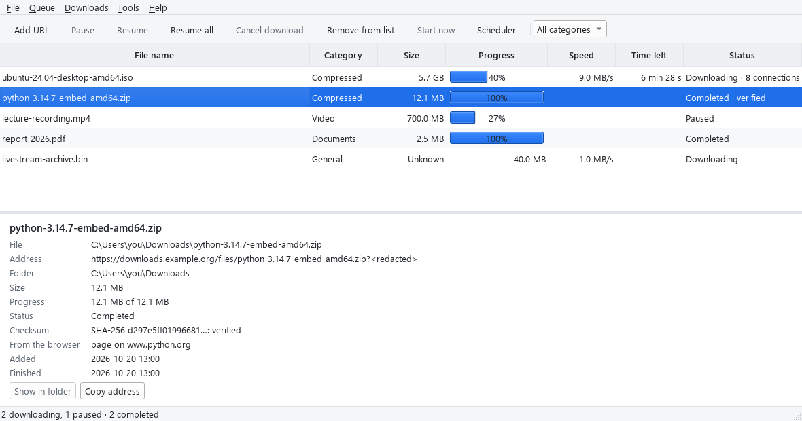
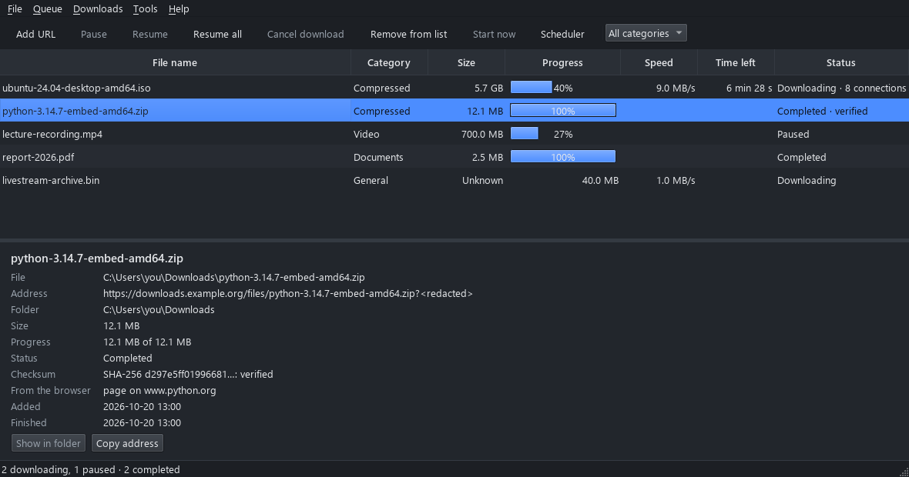

# SDM: Smart Download Manager

A free, open-source download manager for Windows. SDM downloads big files over up to 8
connections at once, pauses and resumes (even after a restart or a crash), queues and
schedules downloads, checks files against their SHA-256, and takes downloads straight from
your browser.

SDM is written from scratch in Python. It is independent and not affiliated with any other
download manager.



<details>
<summary>Dark mode (follows Windows, or choose it in Tools > Settings)</summary>



</details>

## Features

- **Fast:** splits large files over up to 8 connections when the server allows it, and keeps
  splitting as parts finish.
- **Pause and resume:** across restarts and crashes; SDM checks the server's file hasn't
  changed before continuing, so versions are never mixed.
- **Queue and scheduler:** run up to 8 downloads at once, in your order, only between set
  times if you like; temporary failures retry by themselves.
- **Browser integration:** once the extension is installed, clicking a download opens SDM
  instead of the browser's Save As (a switch in the extension turns this off), and you can
  right-click any link or player and choose **Download with SDM**.
- **Safe by default:** never runs downloaded files, never overwrites a file, refuses addresses
  on your own computer and local network unless you allow them, and checks SHA-256 when you
  give one.
- **Comfort:** a shared speed limit, categories, Windows notifications, Show in folder, an
  optional tray icon.

## Install

1. Download `SDM-Setup-<version>.exe` from the [latest release](../../releases/latest).
2. Run it. Windows SmartScreen may say "Windows protected your PC", because SDM isn't
   code-signed (signing costs money): click **More info**, then **Run anyway**.
3. SDM installs for your Windows account only (no administrator rights) and appears in the
   Start menu. Uninstall it from Windows **Settings > Apps**; your history and downloads stay.

Requirements: Windows 10 or 11, 64-bit.

### Connect your browser

Install SDM's extension and register it from SDM: see [extension/README.md](extension/README.md).

Start SDM normally (from the Start menu). If it runs **as administrator**, Windows doesn't let
the browser reach it, and SDM shows a warning.

## Build from source

You need Windows 10/11, [uv](https://docs.astral.sh/uv/) and Git. uv installs the right
Python by itself.

```powershell
git clone https://github.com/Conditions-tech/SDM.git
cd SDM
uv sync                                     # creates .venv with the exact locked versions
uv run python app.py                        # starts SDM
uv run sdm-get https://example.com/file.zip # a one-off download from the command line
uv run python scripts/check_all.py          # lint, all tests, extension tests
uv run python scripts/build_release.py      # dist\SDM; add --installer with Inno Setup 6
```

`sdm-get` never overwrites a file (an existing `file.zip` becomes `file (1).zip`) and refuses
addresses on this computer, and on your local network unless you pass `--allow-local-network`.

## How it's built

| Path | What it is |
|---|---|
| `src/sdm/engine/` | The download engine (asyncio + aiohttp); never imports Qt |
| `src/sdm/ui/` | The window (PySide6 / Qt) |
| `src/sdm/storage/`, `src/sdm/scheduler/` | History (SQLite), queue and schedule |
| `src/sdm/bridge/` | The browser bridge: native messaging host and its local pipe |
| `extension/` | The browser extension and its tests |
| `tests/` | Unit, integration (local test server) and security tests, including fuzzing |
| `packaging/`, `scripts/` | Windows build, installer, performance and check scripts |
| `docs/` | Architecture, security model, decisions (ADRs), roadmap, research notes |

Every design decision is recorded in the
[architecture decision records](docs/decisions/architecture-decision-records.md); the
[security model](docs/architecture/security-model.md) lists the rules SDM follows and the tests
that prove them. The project was built milestone by milestone: see the
[roadmap](docs/roadmap.md) and the [changelog](CHANGELOG.md).

## Contributing and security

Contributions are welcome: see [CONTRIBUTING.md](CONTRIBUTING.md). To report a security
problem, follow [SECURITY.md](SECURITY.md) instead of opening a public issue.

## License

SDM is licensed under the [Apache License 2.0](LICENSE); see also [NOTICE](NOTICE). The
Windows build bundles Python, Qt/PySide6 (LGPL-3.0), aiohttp and other libraries under their
own licences, listed in `THIRD-PARTY-NOTICES.txt` next to `SDM.exe`. Names of other products
belong to their owners.
